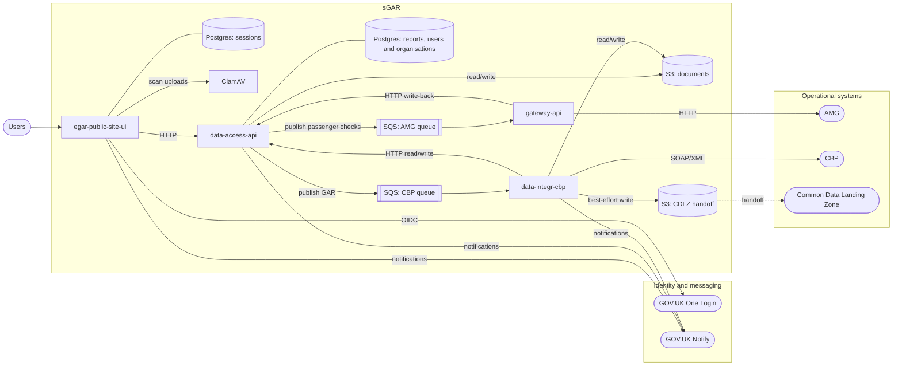

# sGAR application context

This diagram shows the logical connections between the sGAR application and its dependencies. It
does not specify infrastructure, network boundaries or deployment topology.

- sGAR and Online APIS use separate deployed instances of `data-access-api` and `gateway-api`, even
  though they share those codebases. CBP and CDLZ integration is sGAR-only. The Online APIS diagram
  is in `ssar-public-site-ui/docs/application-context.md`.
- Session and report data are shown separately by role; the diagram does not specify whether they
  use separate physical database hosts.
- The dotted CDLZ connection represents a handoff, not a specified transfer mechanism. Confirm
  production resource placement and platform details separately before migration.
